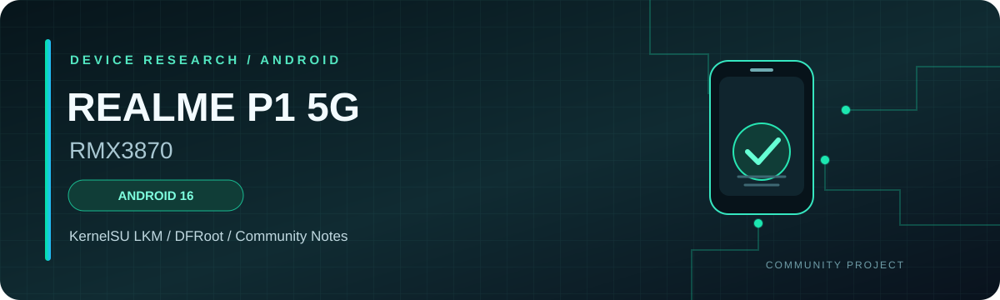

Realme P1 5G & Realme Narzo 70 Pro 5G

Android 16 · KernelSU / KernelSU Next · DFRoot

""RMX3870" (https://img.shields.io/badge/REALME%20P1%205G-RMX3870-00C896?style=for-the-badge)" (#device-details)
""RMX3868" (https://img.shields.io/badge/NARZO%2070%20PRO%205G-RMX3868-00B8D9?style=for-the-badge)" (#device-details)
""Android" (https://img.shields.io/badge/ANDROID-16-3DDC84?style=for-the-badge&logo=android&logoColor=white)" (#device-details)
""KernelSU" (https://img.shields.io/badge/ROOT-KernelSU%20%2F%20Next-8B7CFF?style=for-the-badge)" (#downloads)

Device-specific documentation · Android rooting · Community project

"Overview" (#overview) · "Devices" (#device-details) · "Downloads" (#downloads) · "Steps" (#step-by-step-usage) · "Screenshots" (#screenshots)

---

Overview

This repository documents the reported Android 16 configuration and DFRoot application workflow for two Realme devices:

- Realme P1 5G — RMX3870
- Realme Narzo 70 Pro 5G — RMX3868

The documented setup uses DFRoot v4.7 with either KernelSU or KernelSU Next. This is a running-kernel-based root workflow, and root access may be temporary rather than permanent.

«[!IMPORTANT]
This is independent community documentation, not an official rooting release. The documented workflow reports root access with a locked bootloader, but results may vary by firmware and device configuration.»

Device Details

Property| Realme P1 5G| Realme Narzo 70 Pro 5G
Model| "RMX3870"| "RMX3868"
Android| "16"| "16"
realme UI| "7.0"| "7.0"
Firmware| "RMX3870_16.0.5.1200(EX01)"| "RMX3868_16.0.5.1201"
Security patch| "1 August 2026"| "1 August 2026"
Kernel| "6.6.118-android15-8-o-g25c0665dd40c-4k"| "6.6.118-android15-8-o-g25c0665dd40c-4k"
Bootloader| Locked| Locked
Root applications| KernelSU / KernelSU Next + DFRoot| KernelSU / KernelSU Next + DFRoot

RMX3870 — Reported Status

Property| Observed value
KernelSU Manager| "v3.3.1 (32680-5)"
Displayed status| "Working [Jailbreak mode]"
Mode| "LKM"
SELinux| Reported permissive

RMX3868 — Reported Status

Property| Observed value
KernelSU Manager| "v3.3.1 (32680-5)"
Displayed status| "Working [Jailbreak mode]"
Mode| "LKM"
SELinux| Reported permissive

The information describes the reported device configurations. Compatibility with other firmware builds has not been established.

Downloads

Choose ONE KernelSU option

""KernelSU" (https://img.shields.io/badge/Download-KernelSU-536DFE?style=for-the-badge&logo=github)" (https://github.com/tiann/KernelSU)

"Official KernelSU repository" (https://github.com/tiann/KernelSU)

 ""KernelSU Next" (https://img.shields.io/badge/Download-KernelSU%20Next-8B7CFF?style=for-the-badge&logo=github)" (https://github.com/KernelSU-Next/KernelSU-Next/releases)

"KernelSU Next releases" (https://github.com/KernelSU-Next/KernelSU-Next/releases)

 DFRoot v4.7

""DFRoot" (https://img.shields.io/badge/Download-DFRoot%20v4.7-00C896?style=for-the-badge&logo=android)" (https://github.com/diabl0w/DFRoot/releases/download/v4.7/DFRoot_4.7.apk)

"All DFRoot releases" (https://github.com/diabl0w/DFRoot/releases)

Choose KernelSU or KernelSU Next — whichever you prefer. Use a compatible installation for your device and download applications only from sources you trust.

Requirements

- Realme P1 5G ("RMX3870") or Realme Narzo 70 Pro 5G ("RMX3868").
- KernelSU or KernelSU Next.
- DFRoot v4.7.

Step-by-Step Usage

Step 1 — Download the apps

Download your preferred KernelSU Manager option and DFRoot from the links above.

Step 2 — Open KernelSU

Open KernelSU Manager and leave the app running in the background.

Step 3 — Open DFRoot

Open DFRoot, select KernelSU, and tap Launch Root.

And boom, you're root baby 🔥

If the operation succeeds, root access should be available for the current running-kernel session.

Temporary Root & Reboot Behavior

This workflow uses the running kernel and should be treated as temporary root access, not a permanent modification to the boot image.

- Normal reboot: Root access will be lost. Open KernelSU Manager, then repeat the same DFRoot process.
- Automatic startup: In DFRoot, open Settings and enable Start at boot.
- Auto soft reboot: Enable Auto soft reboot in DFRoot Settings.

These settings are intended to automate parts of the workflow, but enabling them does not guarantee that root will be restored after every restart. Confirm the result on your device.

A soft reboot does not necessarily remove KernelSU root access, but behavior depends on the running kernel and implementation. Verify the actual state rather than assuming that root always survives.

Screenshots

Realme P1 5G — RMX3870

KernelSU Status| Firmware Details| DFRoot
"KernelSU status" (assets/kernelsu-status.jpg)| "RMX3870 firmware" (assets/device-version.jpg)| "DFRoot" (assets/dfroot.jpg)

The screenshots document the reported RMX3870 configuration. Ensure that all three files exist in "assets/" with the exact filenames shown above.

Compatibility Reports

Community testing is welcome. Include the following when reporting results:

Device:
Model:
Firmware:
Android version:
Security patch:
Kernel:
KernelSU / KernelSU Next:
DFRoot version:
Root result:
Normal reboot result:
Soft reboot result:
Issues:

A successful result on one firmware does not establish compatibility with every build.

Security Notes

- Root access increases the impact of malicious applications and unsafe commands.
- Kernel modifications can cause instability or boot issues.
- Never use boot-related images from another device or firmware.
- Permissive SELinux weakens Android security and is not recommended as a general daily-use configuration.

Credits

- "DFRoot by diabl0w" (https://github.com/diabl0w)
- "KernelSU" (https://github.com/tiann/KernelSU)
- "KernelSU Next" (https://github.com/KernelSU-Next/KernelSU-Next)
- Realme device community and contributors

Disclaimer

This is an independent community documentation project. It is not affiliated with or endorsed by realme, DFRoot, KernelSU, or KernelSU Next.

The documented workflow does not guarantee root access on every device or firmware. Root access may be temporary and may be lost after a normal reboot. All modifications are performed at the user's own risk.

---

Found this useful? ⭐ Star the repository and share your results.

REALME P1 5G · RMX3870 / REALME NARZO 70 PRO 5G · RMX3868

Android 16 · 1 August 2026 security patch · Community documentation

