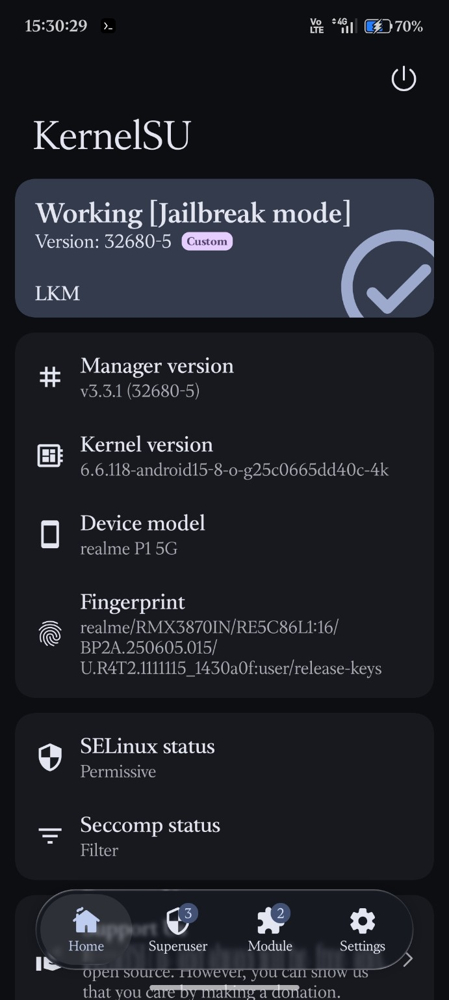
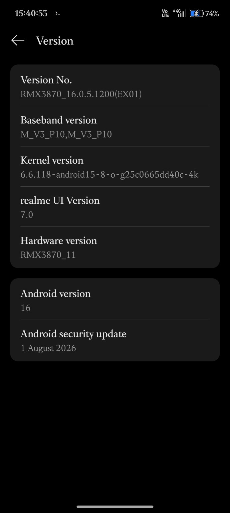
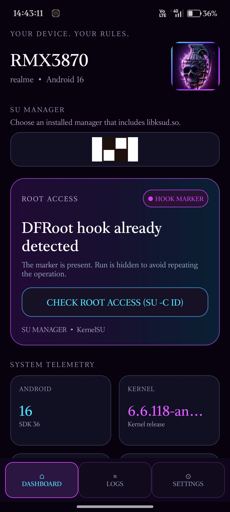

# Realme P1 5G · RMX3870
### Android 16 Rooting Notes — KernelSU + DFRoot

**Device-specific documentation · Community project · Independent and unofficial**

A documented root setup on **Realme P1 5G (RMX3870)** running **Android 16 / realme UI 7.0**, with **KernelSU in LKM mode** and DFRoot.

---

## ✨ Verified device details

| Item | Value |
|---|---|
| Device | realme P1 5G |
| Model | `RMX3870` |
| Firmware / Version No. | `RMX3870_16.0.5.1200(EX01)` |
| Android version | `16` |
| realme UI | `7.0` |
| Android security update | `1 August 2026` |
| Kernel | `6.6.118-android15-8-o-g25c0665dd40c-4k` |
| Build fingerprint | `realme/RMX3870IN/RE5C86L1:16/BP2A.250605.015/U.R4T2.1111115_1430a0f:user/release-keys` |
| KernelSU manager | `v3.3.1 (32680-5)` |
| KernelSU status shown | `Working [Jailbreak mode]` |
| KernelSU mode | `LKM` |
| SELinux status shown | `Permissive` |
| DFRoot source | [DFRoot v4.7 release APK](https://github.com/diabl0w/DFRoot/releases/download/v4.7/DFRoot_4.7.apk) |

> **Test scope:** The screenshots document this configuration on one device. They do not establish compatibility with every RMX3870 firmware, region, or security patch.

## 📸 Screenshots

The screenshots in [`assets/`](assets/) are the evidence for the device/build information and the displayed KernelSU/DFRoot state.

| KernelSU status | Android / firmware details | DFRoot |
|---|---|---|
|  |  |  |

## 🧰 Tools and references

- **DFRoot:** [DFRoot v4.7 APK release](https://github.com/diabl0w/DFRoot/releases/download/v4.7/DFRoot_4.7.apk)
- **KernelSU:** [Official KernelSU project](https://github.com/tiann/KernelSU)
- **This repository:** Device-specific notes, observed versions, screenshots, and community compatibility reports.

Please read the original projects' documentation and license terms before redistributing their software. This repository does not claim ownership of DFRoot or KernelSU.

## ⚠️ Important safety notes

- Rooting and kernel-level modifications can cause data loss, bootloops, loss of OTA updates, or an unusable device.
- Back up important data and keep the exact stock firmware / original boot-related images and a recovery route for your build before experimenting.
- Never flash an image intended for a different model, region, or firmware build.
- Do not assume that a method survives a reboot or works after an OTA update unless you have tested it.
- SELinux is shown as **Permissive** in the provided screenshot. This weakens Android's security protections; do not treat this configuration as a security recommendation.
- Download APKs only from sources you trust, and verify their authenticity when checksums/signatures are available.

## 🧪 Compatibility reports

If you test this on another RMX3870, please report:

1. Exact firmware version and security patch date.
2. Whether the device booted normally after the procedure.
3. KernelSU mode/status and whether root access works after reboot.
4. Any bugs, failures, or recovery steps required.

Do not report a firmware as supported based only on the model name.

## 🤝 Credits

- [DFRoot by diabl0w](https://github.com/diabl0w)
- [KernelSU](https://github.com/tiann/KernelSU)
- Realme P1 5G community testers and contributors

## 📄 Disclaimer

This is an independent, community-maintained documentation project. It is **not affiliated with or endorsed by realme, DFRoot, or KernelSU**. Use at your own risk. You are responsible for understanding the changes you make to your device.

---

**Found this useful?** Star the repository ⭐ and share verified compatibility reports.

